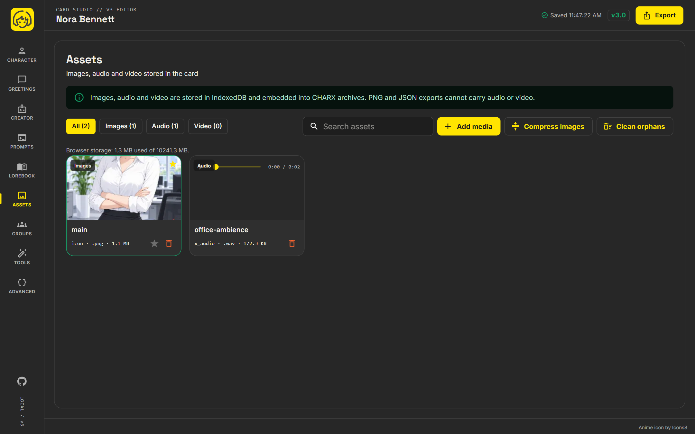

# Character Card Studio

**All-in-one editor for V3 character cards and lorebooks.**

[Open the app](https://bigsombar.github.io/character-card-studio/) ·
[CHARX guide](docs/CHARX.md) ·
[Assets guide](docs/ASSETS.md) ·
[Design system](docs/DESIGN.md) ·
[Release checklist](docs/RELEASE.md)


## Overview

Character Card Studio is a local-first editor for CCv3 cards and CHARX archives. It is built for
card creators and tooling authors who need direct control over fields, embedded media and archive
packaging that general-purpose chat frontends do not expose.

Everything runs in the browser. Cards are stored in IndexedDB, media stays on your device, and
there is no backend, account or telemetry.

## Highlights

### Complete V3 editing

- Character, greeting, creator, prompt, lorebook, group greeting and advanced sections.
- Lorebook uses a two-column workspace: book settings on the left, entries on the right. The portrait column and card file strip are hidden on Lorebook and Assets so those views get the full editor width.
- Lorebook metadata and entries are grouped into metadata, retrieval, triggers, ordering, flags, content and advanced JSON, with compact tri-state boolean controls. Per-entry Advanced JSON is hidden by default and revealed for all entries with a Lorebook header toggle, since imported `extensions` can be very large.
- Full lorebook V3 fields: `use_regex`, `position`, `id`, `priority`, `insertion_order` and
  per-entry `extensions`.
- Multilingual creator notes with ISO 639-1 validation.
- Read-only creation/modification dates, source links, tags and raw JSON editing.
- Multiline text fields grow with their content, so long descriptions, greetings and lorebook entries are fully visible without manual resizing.
- Silent date normalization: seconds, milliseconds, numeric strings and ISO dates all import as valid V3 timestamps.
- `{{user}}` and `{{char}}` macros are highlighted in long-form text fields, alongside muted-yellow `"quoted"` text and grey italic `*text*`.
- Help tooltips on every field.

### Media that survives export

- Add, preview, play, replace and delete images, audio and video.
- Asset metadata lives in the card; binaries live in IndexedDB.
- Download images, GIFs, audio and video linked from card text into local assets, then rewrite those URLs to `embeded://` references. Includes parallel downloads, progress, per-link retry and an import prompt. Hosts that block browser downloads can use an opt-in third-party CORS proxy fallback (10 services, 5 seconds per proxy attempt) after a one-time risk confirmation.
- Main icon and background selection with one-click portrait replacement.
- Megapixel compression for the portrait and for every local image asset at once (2, 1.5, 1 or 0.5 MP): aspect ratio is preserved, both sides snap to a 16 px grid, and images already below the target are never upscaled.
- Thumbnail previews, orphan cleanup and browser storage estimates.

### One export pipeline

- **CHARX** — recommended; `card.json` plus every media file in a ZIP archive.
- **V3 JSON** — optional inline data URLs for self-contained files.
- **V3 PNG** — portrait plus `ccv3`; intentionally lossy and clearly warned. PNG chunks are parsed with signature, length and CRC-32 validation, so a corrupted chunk cannot silently poison an import.
- Pre-export validation blocks structural errors and lists warnings.
- V2 input is accepted and upcast to V3; V2 output is intentionally removed.

### Safety and quality

- Zip-slip, zip-bomb and encrypted-archive protection.
- HTTP asset URIs are preserved but never loaded.
- `ErrorBoundary` recovery, unified notifications and accessible dialogs.
- 277 unit, integration, security, performance and axe tests.
- Lighthouse Accessibility 100 on the main editor surfaces.

## Screenshots

| Assets and media | Lorebook V3 fields |
|---|---|
|  |  |


## Supported formats

| Input | Output | Notes |
|---|---|---|
| `.charx` | `.charx` | Primary format. `card.json` at the archive root and media under `assets/`. |
| `.json` | `.json` | V3 JSON; media can be inlined as data URLs. |
| `.png` | `.png` | Embedded `ccv3` tEXt chunk. Export keeps only the portrait and main icon. |
| `.png` with V2 `chara` | — | Imported and upcast to V3. |
| V2 JSON | — | Imported and upcast to V3. |
| Standalone lorebook JSON | lorebook JSON | `{ "spec": "lorebook_v3", "data": ... }`. |

## Local-first by design

- No server, login or analytics.
- Project metadata is autosaved to IndexedDB.
- Media binaries are stored in IndexedDB, not `localStorage`.
- Network requests happen only for HTTPS assets you preview or explicitly embed.
- Clearing site data removes local assets; export a backup first.

## Getting started

Requires Node.js 22 or newer.

```bash
npm ci
npm run dev        # http://localhost:3000
npm run lint
npm run test:run
npm run build
npm run preview    # http://localhost:4173/character-card-studio/
```

The stack is Vite 8, React 19, MUI 9 and Vitest 5. IndexedDB uses `idb`; CHARX uses
`@zip.js/zip.js` with Web Workers.

## Documentation

- [CHARX format, paths and security limits](docs/CHARX.md)
- [Media assets, storage and URI rules](docs/ASSETS.md)
- [Design system and accessibility](docs/DESIGN.md)
- [Release checklist](docs/RELEASE.md)
- [CCv3 specification](SPEC_V3.md)

## Quality checks

```text
npm run lint      0 errors / 0 warnings
npm run test:run  277 passed / 277
npm run build     production bundle, ~112 kB gzip main chunk
```

CI runs the same checks on Node 22. Deployment publishes the production build to GitHub Pages.

## Deployment

The GitHub Actions workflow builds the app and publishes `dist/` to the `gh-pages` branch. The
production base path is `/character-card-studio/`, and `_config.yml` provides the site title and
description.

Live app: <https://bigsombar.github.io/character-card-studio/>

Repository: <https://github.com/bigsombar/character-card-studio>

## License

Character Card Studio is licensed under the [GNU Affero General Public License v3.0 or later](LICENSE)
(`AGPL-3.0-or-later`).

## Credits

Character Card Studio is inspired by the original V2 character card editor by
[zer0gear](https://github.com/zer0thgear/character-card-editor) (GitHub:
[zer0thgear](https://github.com/zer0thgear)). The current editor is an independent CCv3-focused
project with its own interface, media pipeline and export formats.

Site icon: [Anime](https://icons8.com/icon/MTivAq0U9TSN/anime) icon by
[Icons8](https://icons8.com). The attribution also appears in the site footer as required by the
free license.
