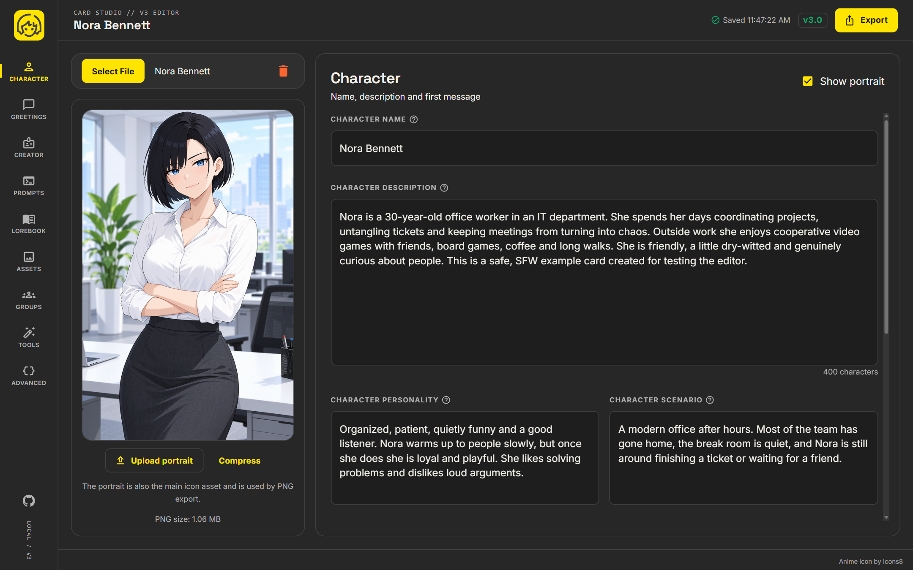
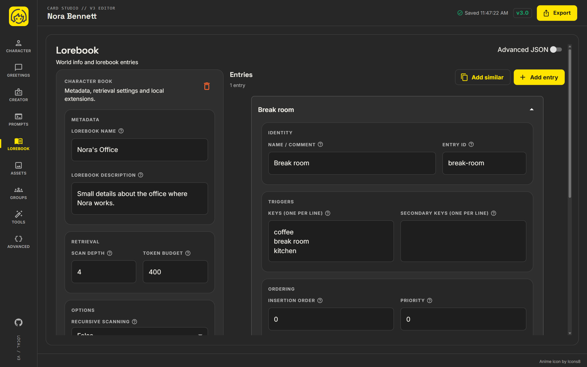
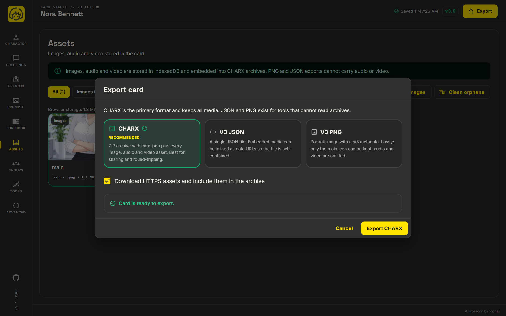
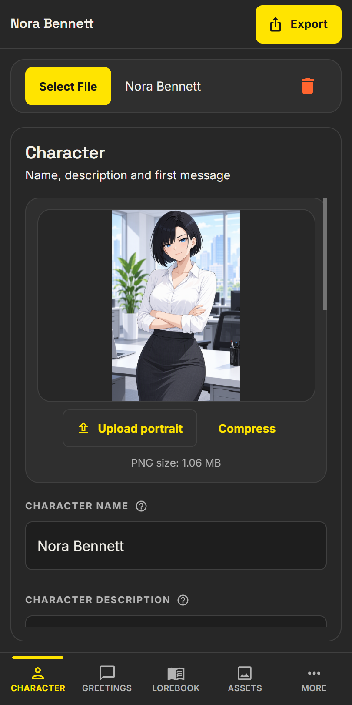
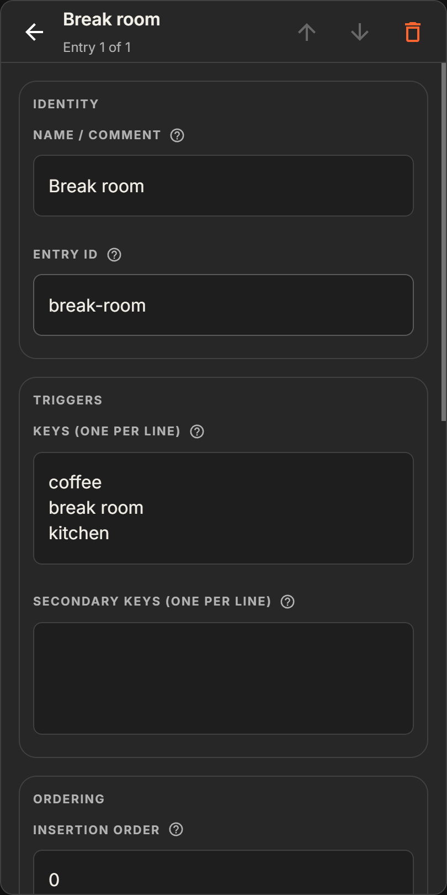

# Character Card Studio

<p align="center">
  <a href="https://bigsombar.github.io/character-card-studio/">
    
  </a>
</p>

**A free, browser-based editor for Character Card V3 and lorebooks.**

[Open the app](https://bigsombar.github.io/character-card-studio/) ·
[GitHub](https://github.com/bigsombar/character-card-studio) ·
[License](LICENSE)



## What it is

Character Card Studio helps you create, edit and export Character Card V3 (CCv3) cards and
lorebooks for SillyTavern and other compatible frontends. It covers the whole card: character
details, greetings, prompts, tags, creator notes and a full lorebook editor.

Everything runs in your browser. There is no account, installation, backend or telemetry, and your
cards and media stay on your device.

## Why use it

- **Complete V3 editing.** Every card field in one place, including alternate greetings, group
  greetings, system prompts, multilingual creator notes, source links and advanced JSON.
- **A real lorebook workspace.** Edit entries, keys, secondary keys, regex triggers, ordering,
  priorities and per-entry extensions without hand-editing JSON. Duplicate an entry with
  **Add similar**, reorder entries by dragging, and work through entries comfortably on mobile.
- **Media that stays with the card.** Add, preview, replace and delete images, audio and video.
  Download media linked from card text, choose the main icon, and compress large images without
  losing the aspect ratio.
- **Exports for every workflow.** Save a complete CHARX archive with all media, a portable V3 JSON
  file, or an image-based V3 PNG. Cards are validated before export so structural mistakes do not
  slip through.
- **V2 cards are welcome.** Import V2 PNG and JSON cards; they are converted to V3 automatically.
  V2 export is intentionally not supported.
- **Private by default.** Projects and media are saved in your browser. Nothing is uploaded to a
  server, and external asset links are never loaded automatically.
- **Desktop and mobile.** The editor adapts to smaller screens with a compact shell and a
  list-to-detail lorebook workflow.
- **Helpful while you write.** Field tooltips, live character counts, highlighted `{{user}}` and
  `{{char}}` macros, and clear validation messages.

## Supported formats

| Format | Import | Export | Notes |
|---|---|---|---|
| CHARX | ✅ | ✅ | Recommended. The card and all media in one archive. |
| V3 JSON | ✅ | ✅ | Portable card file; media can be inlined. |
| V3 PNG | ✅ | ✅ | Image card with embedded card data. Extra media is not included. |
| V2 PNG / JSON | ✅ | — | Converted to V3 on import. |
| Lorebook JSON | ✅ | ✅ | Standalone lorebook files. |

## Your data stays local

Character Card Studio saves your work in browser storage. Clearing site data removes local projects
and assets, so export a backup before cleaning your browser. Network requests only happen for HTTPS
assets you preview or explicitly embed.

## Screenshots

| Assets and media | Lorebook editor |
|---|---|
|  |  |



| Mobile character editor | Mobile lorebook editor |
|---|---|
|  |  |

## Run locally

Requires Node.js 22 or newer.

```bash
npm ci
npm run dev
npm run lint
npm run test:run
npm run build
```

The production build is created with `npm run build`.

## Documentation

- [CHARX format guide](docs/CHARX.md)
- [Assets and media guide](docs/ASSETS.md)
- [Design system](docs/DESIGN.md)
- [Comment and JSDoc style](docs/CODE_COMMENTS.md)
- [Release checklist](docs/RELEASE.md)
- [CCv3 specification](SPEC_V3.md)

## License

Character Card Studio is licensed under the
[GNU Affero General Public License v3.0](LICENSE) (`AGPL-3.0`).

## Credits

Inspired by the original V2 character card editor by
[zer0gear](https://github.com/zer0thgear/character-card-editor).

Site icon: [Anime](https://icons8.com/icon/MTivAq0U9TSN/anime) icon by
[Icons8](https://icons8.com). The attribution also appears in the site footer as required by the
free license.
